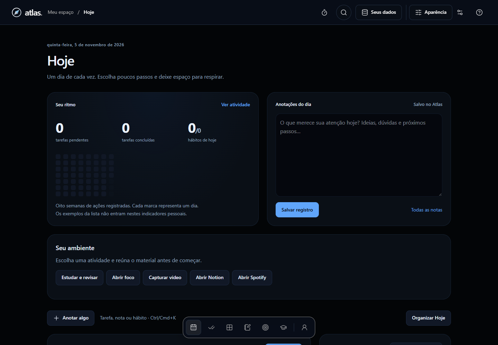

<div align="center">

# Atlas

### A calmer place for your day.

Tasks, habits, notes, goals and study sessions in one local-first workspace.

[**Open Atlas →**](https://ArthurLAragao.github.io/atlas/) · [Getting started](#getting-started) · [Documentation](#documentation) · [Lumen](https://github.com/ArthurLAragao/lumen-organizer)




</div>

## Your day, connected

| Workspace            | What it does                                                               |
| -------------------- | -------------------------------------------------------------------------- |
| **Today**            | Daily overview, activity heatmap, tasks, habits and a weekly focus.        |
| **Tasks & habits**   | Lists, Kanban, calendar, recurring tasks, streaks and quantitative habits. |
| **Notes**            | Markdown editing, templates, tags, search and linked notes.                |
| **Goals & projects** | Track outcomes and connect tasks, notes and project references.            |
| **Studies & focus**  | Subjects, flashcards, study plans and a configurable focus timer.          |
| **Your preferences** | Themes, accessibility, widget layout, profile and local backups.           |

The bottom navigation stays consistent across the workspace. **Ctrl/Cmd + K** opens
quick capture and search; **?** shows keyboard shortcuts outside text fields.

## Use the public app

Open **[Atlas on GitHub Pages](https://ArthurLAragao.github.io/atlas/)**.
No account or API key is required for the core organizer. Your data stays in your
browser's IndexedDB; it is not committed to this repository or shared between visitors.

**The local desktop and GitHub Pages have separate storage.** Export a JSON backup
from the original Atlas before importing it into another browser, device or origin.
There is no automatic cloud sync. Clearing site data can remove your records.
Example content is illustrative, not the owner's personal routine.

Lumen video capture and desktop app launching require the local companion. GitHub
Pages does not run that service. Use the desktop workspace for those integrations.

## Getting started

Use Node.js **24+** and npm:

```sh
git clone https://github.com/ArthurLAragao/atlas.git
cd atlas
npm ci
npm run dev
```

```sh
npm run lint
npm run typecheck
npm test
npm run build
```

The normal build supports the existing local desktop route structure. The Pages
workflow sets `GITHUB_PAGES=true`, uses `/atlas/` as the base, scopes the PWA to that
directory and enables hash routes so navigation and reload work on static hosting.
The local app's URLs and data schema are preserved.

## Project map

```text
src/app/           App shell, routes and shared state
src/components/    Reusable interface components
src/features/      Tasks, habits, notes, goals, studies and profile
src/data/          Models, IndexedDB and repositories
src/lib/           Pure application rules and tests
src/styles/        Design tokens and feature styles
docs/              Architecture, decisions and verification history
e2e/               Browser checks
.github/workflows/ Build checks and GitHub Pages deployment
```

## Documentation

- [Architecture](docs/ARCHITECTURE.md) · [Data and privacy](docs/DATA-AND-PRIVACY.md)
- [Design system shared with Lumen](docs/DESIGN-SYSTEM-ATLAS-LUMEN.md)
- [Local Lumen integration](docs/CAPTURE-WORKSPACE.md)
- [Publishing and verification](docs/PUBLISHING.md)
- [Implementation history and limitations](docs/IMPLEMENTATION-NOTES.md)
- [Contributing](CONTRIBUTING.md) · [Security](SECURITY.md) · [MIT license](LICENSE)

Automated checks do not replace physical-device, screen-reader or human usability
validation. Historical performance limitations remain documented; publishing does
not imply that every earlier release target has been met.
